# 🚀 Engineering Projects Showcase

A curated catalog of production systems, SaaS platforms, enterprise ERPs, and specialized APIs engineered and architected by **Yashin Chauhan**.

---

## 📌 Featured Projects Portfolio

| Project | Domain / Industry | Core Tech Stack | Architectural Highlights | Showcase Document |
| :--- | :--- | :--- | :--- | :--- |
| **🛍️ LocoShopee** | Hyperlocal Quick Commerce & Retail SaaS | `React Native (Expo 51)`, `Next.js 14`, `Express`, `TypeScript`, `Prisma 5`, `PostgreSQL`, `Cloudflare R2` | 0% commission direct P2P UPI settlement, multi-vendor cart splitting, 2–20 km Haversine search, deterministic order state machine, 430/430 tests passing | [View Deep Dive ➔](./locoshopee.md) |
| **🎯 TargetTNgrp4** | EdTech / Competitive Exam SaaS | `Next.js 16 App Router`, `React 19`, `TypeScript (Strict)`, `Prisma 5`, `PostgreSQL`, `Tailwind v4` | Authentic 200Q/180-min exam engine, zero answer leakage server scoring, automated spaced-repetition Mistake Book, dual independent JWT/DB auth | [View Deep Dive ➔](./targettngrp4.md) |
| **🎓 E-Academy** | EdTech / Multi-Institute LMS & Virtual Class | `PHP 7.4/8.x`, `CodeIgniter 3`, `MySQL`, `WebRTC (Jitsi Meet)`, `Bootstrap 4`, `Razorpay` | Multi-branch tenant data isolation (`admin_id`), browser-native WebRTC live classroom, 12K+ LOC async DataTables engine, multi-batch enrollment | [View Deep Dive ➔](./e-academy-lms.md) |
| **🗺️ Bearing Technology** | Geospatial Engineering & Drone Survey ERP | `PHP 7.4/8.0`, `Laravel 8`, `MySQL`, `Blade`, `DataTables`, `Bootstrap 4` | Dual-guard session auth (`admin_auth` & `user_auth`), field survey photo upload & remarks pipeline, expense audit console, surveyor workforce management | [View Deep Dive ➔](./bearing-technology.md) |
| **🏠 RentKhata** | PropTech / Co-Living SaaS | `Next.js 15`, `NestJS 11`, `React Native (Expo 52)`, `PostgreSQL`, `Prisma 7`, `Redis` | Double-entry financial ledger (integer paise), multi-tenant property hierarchy, sub-meter utility billing, tenant self-service portal | [View Deep Dive ➔](./rentkhata.md) |
| **🚚 Compass Transport** | Freight Logistics & Supply Chain | `PHP 8`, `Laravel 8`, `MySQL 8`, `Blade`, `DomPDF`, `Laravel-Excel` | Multi-branch session isolation (`DLI` vs `UMB`), dynamic counter bilty billing, payment-status GST allocation, high-fidelity vector PDF generation | [View Deep Dive ➔](./compass-transport.md) |
| **🩺 Medilab** | HealthTech / Pathology SaaS | `PHP 8`, `Laravel 8`, `MySQL 8`, `Razorpay API`, `Bootstrap 5` | A-Z diagnostic test search, Razorpay online payment capture, patient portal with 24/7 digital medical report downloads, dual-guard session auth | [View Deep Dive ➔](./medilab-pathology.md) |
| **💎 Gems Testing India** | Gemology & Authenticity Verification | `PHP 8.1+`, `Laravel 10`, `MySQL 8`, `DomPDF 2.0`, `Yajra DataTables` | Sub-8ms multi-table SQL `UNION` lookup engine, 4-tier division schema (Gems, Diamonds, Jewelry, Rudraksha), exact millimeter PVC card PDF engine | [View Deep Dive ➔](./gems-testing-india.md) |
| **🌾 Pragya Crop Advisory** | AgriTech & Grassroots NGO | `PHP 8.1+`, `Laravel 10`, `MySQL 8`, `RESTful API`, `UTF-8 Bilingual Engine` | 12-stage crop lifecycle modeling, composite joins for pest/disease IPM diagnostics, dynamic mobile taxonomy, bilingual Devanagari normalizer | [View Deep Dive ➔](./pragya-crop-advisory.md) |
| **🏛️ Dr. YSP University** | Higher Education & Institutional ERP | `PHP 8`, `Laravel 8`, `MySQL 8`, `Blade`, `DataTables`, `jQuery AJAX` | Asynchronous institutional email & OTP onboarding, dynamic faculty-to-department page binding (`getFaculty`), automated notice/tender auto-expiry | [View Deep Dive ➔](./ysp-university.md) |

---

## 🏗️ Comparative Architecture Matrix

```mermaid
flowchart TD
    subgraph HyperlocalCommerce["Hyperlocal Commerce (LocoShopee)"]
        LS_MOB["Expo 51 (Customer + Seller)"]
        LS_ADM["Next.js 14 Super Admin"]
        LS_BE["Express TS Core (246 Modular Files)"]
        LS_DB[("PostgreSQL (Prisma 5.22) + R2 Vault")]
        LS_MOB --> LS_BE --> LS_DB
        LS_ADM --> LS_BE
    end

    subgraph EdTechExam["Competitive Exam SaaS (TargetTNgrp4)"]
        TN_FE["Next.js 16 Web + OMR Exam Runner"]
        TN_BE["Next.js 16 Server Actions + Prisma 5"]
        TN_DB[("PostgreSQL (Pooled)")]
        TN_FE --> TN_BE --> TN_DB
    end

    subgraph EdTechLMS["Multi-Institute LMS (E-Academy)"]
        EA_FE["Admin + Teacher + Student Web Portals"]
        EA_BE["CodeIgniter 3 MVC + Ajaxcall Engine"]
        EA_RTC["WebRTC Video Bridge (Jitsi Meet)"]
        EA_DB[("MySQL (Multi-Branch Partitioned)")]
        EA_FE --> EA_BE --> EA_DB
        EA_FE -.->|Live Class| EA_RTC
    end

    subgraph GeospatialSurvey["Survey & Drone ERP (Bearing Technology)"]
        BT_FE["Public Portal + Surveyor Upload Desk + Admin Console"]
        BT_BE["Laravel 8 MVC + Dual Session Guards (admin_auth / user_auth)"]
        BT_DB[("MySQL (Users, Images, Remarks, Expenses)")]
        BT_FE --> BT_BE --> BT_DB
    end

    subgraph EnterpriseSaaS["PropTech SaaS (RentKhata)"]
        RK_FE["Next.js 15 Web + Expo 52 Mobile"]
        RK_BE["NestJS 11 Fastify + Prisma 7"]
        RK_DB[("PostgreSQL (Supabase) + Redis")]
        RK_FE --> RK_BE --> RK_DB
    end

    subgraph LogisticsERP["Logistics ERP (Compass Transport)"]
        CT_FE["Blade + CoolAdmin + jQuery"]
        CT_BE["Laravel 8 MVC + DomPDF + Excel"]
        CT_DB[("MySQL 8 (Branch Isolated)")]
        CT_FE --> CT_BE --> CT_DB
    end

    subgraph HealthTech["HealthTech & Pathology (Medilab)"]
        ML_FE["Blade + Bootstrap 5 + A-Z Filter"]
        ML_BE["Laravel 8 + Razorpay SDK + Auth Guards"]
        ML_DB[("MySQL 8 (Users, Reports, Appts)")]
        ML_FE --> ML_BE --> ML_DB
    end

    subgraph LabVerification["Laboratory Verification (GTI)"]
        GTI_FE["Public AJAX Lookup + Yajra DataTables"]
        GTI_BE["Laravel 10 Engine + Union Query Helper"]
        GTI_DB[("MySQL 8 (4-Tier Schema)")]
        GTI_FE --> GTI_BE --> GTI_DB
    end

    subgraph AgriTechAPI["AgriTech API (Pragya Platform)"]
        PA_FE["Farmer Mobile Apps (Android/iOS)"]
        PA_BE["Laravel 10 REST API Gateway"]
        PA_DB[("MySQL 8 (Relational Agronomy)")]
        PA_FE --> PA_BE --> PA_DB
    end

    subgraph InstitutionalERP["Academic ERP (YSP University)"]
        YU_FE["Public Portal + Faculty Self-Service + Admin Console"]
        YU_BE["Laravel 8 MVC + Dual Auth Guards + OTP Engine"]
        YU_DB[("MySQL 8 (Employees, Notifications, Tables)")]
        YU_FE --> YU_BE --> YU_DB
    end
```



---

## 🛠️ Technology Breakdown

```
├── Languages: TypeScript (Strict), JavaScript (ES6+), PHP (7.4, 8.x, 8.1+), SQL, HTML5, CSS3
├── Mobile & Frontend: React Native (Expo SDK 51/52), Next.js (14/15/16 App Router), React (18/19), Tailwind CSS (v3 & v4), Bootstrap (4 & 5)
├── Backend Frameworks: Express.js 4.19 (Modular Monolith), NestJS 11, Fastify 5, Laravel (8.x & 10.x), CodeIgniter 3 MVC, Node.js
├── Real-Time & Video: WebRTC, Jitsi Meet External API, Dynamic Room Hash Generation
├── Databases & ORM: PostgreSQL (Supabase, Neon, Pooling), MySQL 8.x, MongoDB, Prisma (5.x & 7.x), Eloquent ORM
├── Cloud Storage & Vault: Cloudflare R2, AWS S3 (Presigned PUT/GET URLs), Private KYC Buckets, Local Storage
├── Payment & Settlement: Native 1-Tap UPI Intent (upi://pay), Dynamic QR, Razorpay SDK & Webhooks, PayPal SDK
├── Caching & Async: Redis, BullMQ Background Queues
├── Document & Reporting Engines: PDFKit (Indian GST Invoices), Barryvdh DomPDF, Maatwebsite Laravel-Excel, Yajra DataTables, PapaParse
├── DevOps & Cloud: Cloudflare (WAF/DNS), Nginx Reverse Proxy, Apache (.htaccess), Oracle Cloud Infrastructure, PM2, Git, GitHub Actions
```

---

## 📂 Quick Project Navigation

1. **[LocoShopee Architectural Deep-Dive](./locoshopee.md)**
   * 0% order commission peer-to-peer native UPI settlement (`upi://pay`)
   * Dual-role mobile app (Customer $\leftrightarrow$ Seller) built with Expo SDK 51
   * 246 modular backend TypeScript files ($\le 150$ lines/file) with 430/430 tests passing
   * Sub-second 2–20 km Haversine search & multi-vendor smart cart splitting
   * Private KYC document vault on Cloudflare R2 with 5-minute presigned URLs

2. **[TargetTNgrp4 Architectural Deep-Dive](./targettngrp4.md)**
   * Authentic 200-question/180-min exam runner with OMR palette & persistent autosave
   * Server-side evaluation pipeline with zero answer key leakage
   * Automated spaced-repetition Mistake Book with consecutive-correct mastery tracking
   * Dual independent authentication: stateless student JWT vs stateful admin DB sessions
   * Strict 150-line clean code standard across repository

3. **[E-Academy LMS & Virtual Classroom Deep-Dive](./e-academy-lms.md)**
   * Multi-branch tenant data isolation (`admin_id` column migration & session scoping)
   * In-browser WebRTC interactive video streaming with teacher moderator locks
   * High-concurrency asynchronous DataTables controller (`Ajaxcall.php` 12,000+ LOC)
   * Multi-batch student enrollment with hybrid offline/online fee modes (`pay_mode`)
   * Dynamic institute branding customization (`theme_color`) and trilingual translation

4. **[Bearing Technology Drone & Survey ERP Deep-Dive](./bearing-technology.md)**
   * Dual independent session authentication guards (`admin_auth` & `user_auth`)
   * Field surveyor image upload pipeline with dual observational remarks and expense logging
   * Administrative photo evidence audit console and surveyor account management
   * Responsive corporate engineering portal showcasing drone UAV, hydrographic, and contour surveying

5. **[RentKhata Architectural Deep-Dive](./rentkhata.md)**
   * Multi-tenant property inventory modeling
   * Append-only double-entry ledger & integer paise calculations
   * Contract-first OpenAPI client code generation
   * Microservice-ready modular architecture

6. **[Compass Transport Architectural Deep-Dive](./compass-transport.md)**
   * Regional branch context partitioning & ID prefixes
   * Real-time counter bilty drafting & live client auto-completion
   * GST compliance engine based on consignment terms (`PAID` vs `TO PAY`)
   * Consolidated consignee statement vouchers

7. **[Medilab Pathology Laboratory Deep-Dive](./medilab-pathology.md)**
   * Real-time A-Z diagnostic test catalog search engine
   * Direct Razorpay payment gateway integration for test booking fees
   * End-to-end digital report delivery system mapping files to patient profiles
   * Dual-guard session authentication architecture (`admin_auth` & `user_auth`)

8. **[Gems Testing India Architectural Deep-Dive](./gems-testing-india.md)**
   * Universal single-index search resolving across 4 polymorphic laboratory models in <8ms
   * Vector PVC card generation pipeline with custom print stylesheets
   * Asynchronous server-side Yajra DataTables integration
   * Granular batch Excel import validator

9. **[Pragya Crop Advisory Architectural Deep-Dive](./pragya-crop-advisory.md)**
   * Comprehensive 12-stage agricultural decision tree
   * High-performance composite joins for disease & pest mitigation
   * Dynamic taxonomy decoupling mobile app UI from app-store binary updates
   * Devanagari Unicode (`utf8mb4`) and English bilingual data pipeline

10. **[Dr. YSP University Architectural Deep-Dive](./ysp-university.md)**
   * Asynchronous institutional domain verification and session-bound OTP validation
   * Centralized helper architecture (`getFaculty($page)`) for dynamic faculty-to-department page binding
   * Automated date-filtered notice, tender, and recruitment circular expiration engine
   * Multi-campus navigation tree for 4 colleges, 5 research stations, and 5 KVK centers

---

*For technical inquiries, architectural discussions, or collaboration, feel free to reach out via [GitHub](https://github.com/yashin-chauhan) or [Email](mailto:yashin123786@gmail.com).*
