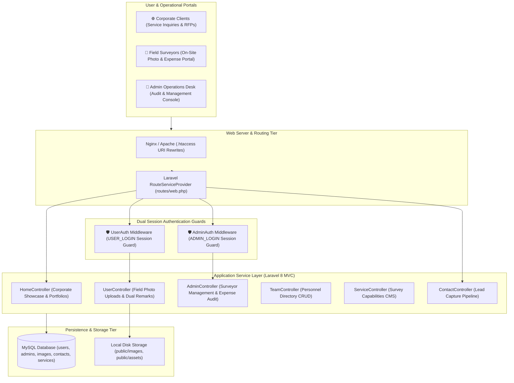

# 🗺️ Bearing Technology — Drone UAV & Topographic Survey Management Platform

> **A comprehensive field survey operations portal, geospatial ground imagery audit system, expense verification pipeline, and corporate services showcase engineered for professional surveying, drone UAV, and hydrographic engineering.**

---

## 💡 Problem Context & Business Domain

Topographic, drone UAV, and hydrographic engineering projects operate across remote geographical terrains, creating heavy administrative and field coordination friction:

* **Disconnected Ground Survey Reporting:** Surveyors on remote site locations capture physical ground markers, benchmarks, and aerial reference points with no unified, authenticated pipeline to submit them to headquarters.
* **Unverified Field Expenses:** Survey crews incur on-site operational costs (labor, transport, equipment permits) recorded on paper vouchers, leading to reconciliation delays and billing mismatches.
* **Security & Authorization Risks:** Blending administrative governance with field staff access in a single auth layer risks unauthorized modification of company services, team profiles, and customer leads.
* **Slow Lead Conversion:** High-value B2B infrastructure clients require immediate visibility into surveying capabilities (Bathymetry, LIDAR, GIS mapping, Contour Surveys) with an interactive quotation pipeline.

---

## 🚀 The Solution & Platform Architecture

**Bearing Technology** delivers a full-stack engineering solution integrating public client acquisition with an internal field operations and expense audit system:

---

## 🧩 Core Platform Subsystems

| Subsystem | Tech Stack | Architectural Function |
| :--- | :--- | :--- |
| **Field Surveyor Portal** | Laravel 8, Blade, Bootstrap 4 | Authenticated interface for on-site surveyors to upload ground photos, specify dual remarks, and log site expenses. |
| **Admin Operations ERP** | CoolAdmin, DataTables, Laravel 8 | Central management console for auditing field submissions, managing surveyor accounts, and reviewing client inquiries. |
| **Dual Session Guard** | Laravel Middleware (`admin_auth`, `user_auth`) | Strict segregation ensuring field staff cannot access admin settings while providing seamless session tracking. |
| **Corporate Showcase CMS** | Blade, Bootstrap 4, Owl Carousel | Responsive commercial web platform highlighting drone UAV, bathymetric, and GIS capabilities with inquiry lead capture. |
| **Evidence & Storage Engine** | Laravel Storage API, PHP File Mimes | Timestamp-based dynamic image naming (`time().ext`), mime validation, and disk storage in `public/images`. |

---

## 🛡️ Key Engineering Highlights & Invariants

### 1. Dual Independent Authentication Middleware
To enforce strict principle-of-least-privilege, the application segregates roles via distinct session keys and middleware guards:
* **`admin_auth`:** Validates `ADMIN_LOGIN` and `ADMIN_ID` session attributes, guarding user provisioning, contact logs, and company services.
* **`user_auth`:** Validates `USER_LOGIN` and `USER_ID` session attributes, strictly limiting field staff to their own uploaded survey photos and expense claims.

### 2. Multi-Stage Field Audit Workflow
Each survey submission captures structured operational parameters:
* `image`: High-resolution photographic evidence stored with timestamped hashing.
* `remark_1` & `remark_2`: Contextual ground observations (e.g. baseline coordinates, weather factors).
* `amount`: Financial reimbursement claimed for site operations.
* `updated`: State flag tracking whether administrative adjustments or remark reconciliations have occurred.

### 3. Server-Side DataTables & User Provisioning
The admin interface integrates DataTables for seamless surveyor roster management, dynamic user editing, and instantaneous search across hundreds of survey submissions.

---

## 👨‍💻 Engineering Ownership

As the Full-Stack Software Engineer on this project during my tenure at **Digitally Bird**, I was responsible for:
* Architecting the end-to-end full-stack application using **Laravel 8 and MySQL**.
* Designing and implementing the dual session authentication middleware architecture (`admin_auth` and `user_auth`).
* Engineering the field surveyor portal allowing on-site photo uploads with dual remarks and expense logging.
* Building the administrative audit console to review field submissions, verify expenses, and manage surveyor accounts.
* Developing the responsive corporate showcase website highlighting drone UAV, topographic, and hydrographic capabilities.
