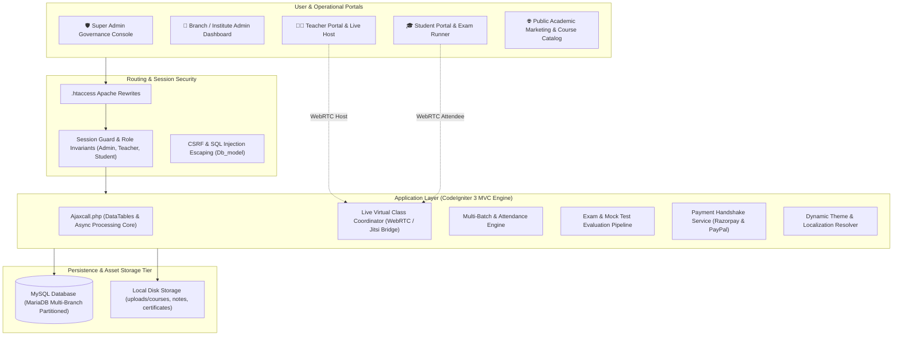

# 🎓 E-Academy — Enterprise Multi-Institute LMS & Virtual Class Operating Platform

> **A scalable, multi-tenant learning management system (LMS), WebRTC-powered virtual classroom, examination & practice test engine, and multi-branch institute governance platform engineered for educational academies.**

---

## 💡 Problem Context & Business Domain

Coaching institutes, test-prep academies, and multi-branch educational centers face significant structural friction in their transition to hybrid and digital education:

* **Multi-Branch Data Fragmentation:** Expanding institutes with multiple branches struggle when student rosters, fee collections, batch schedules, and attendance are mixed in a single global database without branch isolation.
* **Fragmented Remote Learning Tools:** Running live classes requires third-party meeting links (Zoom/Google Meet), while study materials, assignments, and mock tests are distributed on WhatsApp or separate portals.
* **Fee Collection & Multi-Batch Tracking:** Students attending multiple batches (e.g. Physics + Chemistry + Test Series) face manual invoicing errors and cash/UPI reconciliation delays across offline and online modes.
* **Exam Readiness Deficit:** Paper-based or unstructured online quizzes lack question-bank categorization, timed mock environments, and instant performance scorecards.
* **Branding & Localization Barriers:** Regional institutes require custom brand identities (colors, logos) and multilingual interfaces (English, Arabic, French) to cater to diverse student demographics.

---

## 🚀 The Solution & Platform Architecture

**E-Academy** provides an all-in-one institutional operating system uniting administrators, branch managers, instructors, and students into a cohesive, role-segregated platform:

---

## 🧩 Core Platform Subsystems

| Subsystem | Tech Stack | Architectural Function |
| :--- | :--- | :--- |
| **Multi-Branch Admin ERP** | CodeIgniter 3, MySQL, Bootstrap 4 | Centralized management of batches, teachers, students, attendance, leaves, and fee ledgers with branch scoping. |
| **Live Virtual Class Engine** | WebRTC, Jitsi Meet API, JavaScript | In-browser live video lectures with role-based moderation, automated class history logging, and student access guards. |
| **Examination & Mock Engine** | PHP 7.4, jQuery, MySQL | High-throughput timed testing engine with question banking, practice tests, mock results, and automated scoring. |
| **Payment Gateway Suite** | Razorpay SDK, PayPal SDK, MySQL | Dual payment gateway supporting automated webhooks, offline cash tracking, multi-batch receipts, and transaction history. |
| **Academic Content & Library** | CI File Upload, PDF Viewer, MySQL | Structured repository for video lectures, downloadable book PDFs, lecture notes, syllabus matrices, and old papers. |
| **Theme & Whitelabel Engine** | MySQL `theme_color`, CSS Variables | Multi-admin color scheme customization allowing branch admins to brand their portal palette and dashboard layout. |

---

## 🛡️ Key Engineering Highlights & Invariants

### 1. Multi-Tenant Branch Scoping (`admin_id` Invariant)
To transition the architecture from single-institute to an enterprise multi-branch solution, database queries enforce `admin_id` isolation across all core tables (`attendance`, `batches`, `students`, `student_payment_history`, `gallery`, `live_class_history`). Branch managers are strictly restricted to their designated records.

### 2. High-Performance Server-Side DataTables Engine (`Ajaxcall.php`)
A massive asynchronous controller (`Ajaxcall.php` — 12,000+ lines) processes high-volume AJAX data streams for student lists, attendance matrices, batch registries, and question banks with server-side pagination, debounced search, and multi-field sorting.

### 3. Browser-Native WebRTC Live Class Integration
Live classes eliminate client friction by embedding Jitsi Meet external APIs directly into view templates. Room names are dynamically hashed per batch, while teacher sessions automatically gain moderator privileges (`password` lock and kick controls).

### 4. Multi-Batch Student Allocation
Real-world students frequently take cross-disciplinary subjects. The student model separates identity (`students`) from batch allocations (`sudent_batchs`), enabling students to attend multiple batches with unified fee payment tracking.

---

## 👨‍💻 Engineering Ownership

As the Full-Stack Software Engineer on this project during my tenure at **Digitally Bird**, I was responsible for:
* Architecting the transition from single-institute setup to a **multi-branch scoped ERP** via SQL migration scripts (`Update_New.sql`) and `admin_id` session binding.
* Developing the high-throughput asynchronous core controller (`Ajaxcall.php`) handling real-time DataTables pagination, batch allocations, and attendance matrices.
* Integrating the browser-native **Jitsi Meet WebRTC video classroom** with moderator role elevation and class history tracking.
* Implementing the multi-batch student enrollment subsystem (`multi_batch`, `sudent_batchs`) and dual offline/online payment handling (`pay_mode`).
* Building the dynamic whitelabeling engine (`theme_color`) and trilingual localization support (English, French, Arabic).
