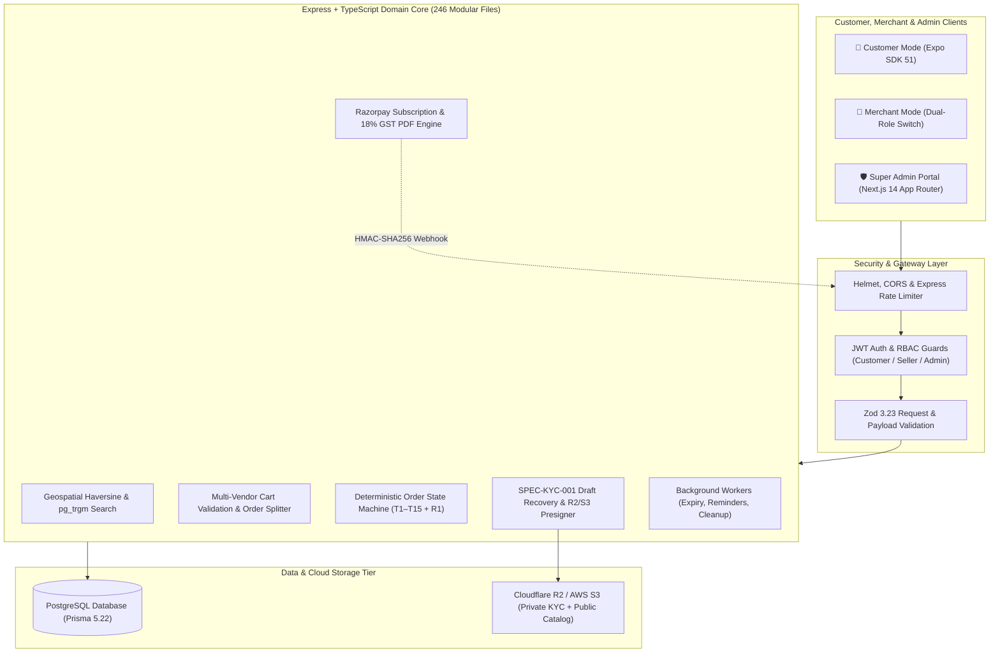

# 🛍️ LocoShopee — Zero-Commission Hyperlocal Marketplace Ecosystem

> **A production-grade, dual-role (Customer & Merchant) mobile commerce platform, geospatial discovery engine, direct peer-to-peer UPI settlement system, and Super Admin governance portal engineered for neighborhood retail across Tamil Nadu & Puducherry.**

---

## 💡 Problem Context & Business Domain

Neighborhood retail merchants across Tamil Nadu and Puducherry face crippling structural barriers on mainstream food and grocery delivery aggregators:

* **Punitive Commissions (15%–30%):** High commission deductions erode thin retail margins on groceries, bakeries, pharmacies, and daily essentials.
* **Delayed Payout Cycles (7–14 Days):** Merchant working capital remains trapped in platform escrow accounts, stalling daily inventory restocking.
* **Inflated Delivery Fees:** Mandatory third-party courier fleets increase order costs for consumers while breaking direct store-customer relationships.
* **Discovery Fragmentation:** Shoppers lack an instant, localized directory to discover neighborhood shops within 2–20 km and transact without middleman markups.

---

## 🚀 The Solution & Platform Architecture

**LocoShopee** disrupts traditional aggregator models with a **0% Order Commission** hyperlocal marketplace funded via transparent merchant SaaS subscriptions:

---

## 🧩 Core Platform Subsystems

| Subsystem | Tech Stack | Architectural Function |
| :--- | :--- | :--- |
| **Dual-Role Mobile App** | React Native, Expo SDK 51, TypeScript | Single unified mobile app featuring radial GPS discovery, multi-vendor cart, 1-tap UPI intent (`upi://pay`), dynamic QR generation, and instant Customer $\leftrightarrow$ Seller switching. |
| **Modular REST API Core** | Node.js, Express 4.19, TypeScript 5.5 | 246 strictly modular files ($\le 150$ lines/file, avg 57.8 lines) powering auth, geospatial search, order state transitions, and billing. |
| **Super Admin Portal** | Next.js 14, React 18, Tailwind CSS 3 | Executive governance portal for merchant KYC document inspection (5-min presigned URLs), GST tax invoices, global order auditing, and referral cashback disbursements. |
| **Deterministic Order Engine** | Prisma 5.22, PostgreSQL, Zod | Complete state machine enforcing 12-digit numeric UTR validation (max 2 attempts), 30-min unpaid auto-expiry, and strict integer paise math. |
| **Private Document Vault** | Cloudflare R2 / AWS S3, `@aws-sdk/client-s3` | `SPEC-KYC-001` draft auto-save and private bucket isolation; sensitive Aadhaar/PAN/GST docs rendered exclusively via temporary 5-min presigned GET URLs. |
| **SaaS Billing & 18% GST Engine** | Razorpay SDK 2.9, PDFKit, Crypto HMAC | Tiered merchant subscription plans (Silver ₹499/3mo, Gold ₹699/6mo, Platinum ₹999/12mo) with HMAC-SHA256 webhooks and gapless PDF tax invoices (SAC 998314). |

---

## 🛡️ Key Engineering Highlights & Invariants

### 1. 0% Commission Direct P2P UPI Settlement
Customers pay merchants directly via native UPI Intent (`upi://pay`) or on-device dynamic QR codes. Funds settle instantaneously between **Customer Bank $\rightarrow$ Merchant Bank** with zero platform escrow, zero commission, and automated 12-digit numeric UTR tracking.

### 2. Financial Precision (Zero Floats for Money)
Every monetary figure across PostgreSQL, Prisma, APIs, and client apps is stored and calculated strictly in **integer minor units (paise)** (`mrpPaise`, `sellingPricePaise`, `totalPaise`, `cgstPaise`, `sgstPaise`, `igstPaise`). Floating-point currency math is strictly forbidden.

### 3. Strict 150-Line Modularization Standard
All **246 TypeScript source files** in the backend core adhere 100% to a strict $\le 150$ lines-per-file ceiling (averaging **57.8 lines/file**), paired with atomic UI decomposition across the Next.js Admin Portal and Expo Mobile App.

### 4. Deterministic Order State Machine & Test Rigor
Order lifecycles are governed by strict actor permissions, automated 30-minute unpaid expiry, and cancel/reject rules. The entire platform passes **430 / 430 backend automated tests (100% pass rate)** with **0 TypeScript compiler errors** across backend, admin, and mobile workspaces.

### 5. Multi-Vendor Smart Cart Splitting & Geospatial Search
Customers can add products from multiple neighborhood shops into a single cart. The checkout engine automatically partitions items into independent per-merchant orders while sub-second radial store queries are driven by Haversine spherical math and PostgreSQL `pg_trgm` fuzzy indexing.

---

## 👨‍💻 Engineering Ownership

As the Lead Software Architect & Full-Stack Engineer, I was responsible for:
* End-to-end system architecture across the **Express REST API**, **Expo SDK 51 Mobile App**, and **Next.js 14 Super Admin Portal**.
* Designing the zero-commission peer-to-peer UPI settlement architecture with native deep-linking and dynamic QR code generation.
* Engineering the deterministic order state machine with 12-digit UTR verification and 30-minute auto-expiry workers.
* Implementing the `SPEC-KYC-001` private document vault with Cloudflare R2 presigned PUT/GET URLs.
* Architecting the Razorpay recurring vendor subscription engine with automated 18% GST PDF invoice generation (SAC 998314).
* Authoring comprehensive test suites achieving a 100% pass rate across 430 automated test cases.
