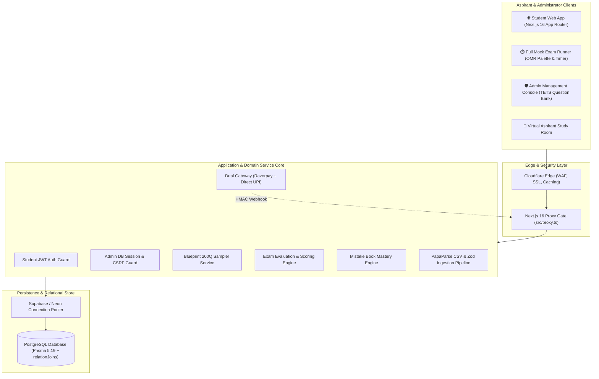

# 🎯 TargetTNgrp4 — Enterprise Bilingual Exam Engine & Aspirant Operating Platform

> **A high-performance, bilingual (Tamil & English) SaaS mock examination engine, syllabus practice platform, and automated mistake diagnostic system engineered for TNPSC Group 4 aspirants.**

---

## 💡 Problem Context & Business Domain

The Tamil Nadu Public Service Commission (TNPSC) Group 4 examination is one of India's largest state government recruitment exams, with over **2,000,000 applicants** competing for fewer than 10,000 vacancies. Aspirants face critical bottlenecks:

* **Extreme Cutoff Margins:** General category cutoffs frequently exceed 260–270 marks out of 300 (170+ correct answers out of 200). A single error alters thousands of ranks.
* **Language Duality & Tamil Nuances:** Part A (General Tamil) requires authentic Tamil typography, literature, grammar, and textbook alignment (Samacheer Kalvi 6th–12th) often lacking in national platforms.
* **Exam Stamina & Pacing Deficit:** Answering 200 questions across 180 minutes (54 seconds per question) demands authentic timer-driven, full-length simulations with OMR-style palettes.
* **Unstructured Mistake Rectification:** Aspirants repeatedly repeat identical conceptual errors without automated spaced-repetition tracking.

---

## 🚀 The Solution & Platform Architecture

TargetTNgrp4 provides a production-grade examination operating platform built specifically around the TNPSC Group 4 blueprint:

---

## 🧩 Core Platform Subsystems

| Subsystem | Tech Stack | Architectural Function |
| :--- | :--- | :--- |
| **Exam State Runner** | Next.js 16, React 19, Lucide Icons | Real-time 200Q test runner with section tabs, OMR answer palette, 180-min countdown timer, network disruption resilience, and autosave. |
| **Server Evaluation Core** | Node.js, Prisma 5.19, Zod 4 | Server-side scoring engine enforcing zero answer leakage, section-wise mark attribution (1.5 marks/Q), and percentile ranking. |
| **Topic Practice Engine** | React 19, Server Actions, Tailwind CSS 4 | Granular practice partitioned by Section $\rightarrow$ Unit $\rightarrow$ Topic with immediate bilingual feedback and answer rationales. |
| **Mistake Book Engine** | Prisma ORM, PostgreSQL | Automated wrong-answer logging with spaced-repetition re-tests and consecutive-correct mastery thresholds. |
| **Admin Question Bank** | TETS Architecture, PapaParse, Zod | Enterprise question curator with server-side pagination, live status tab counts, bilingual preview modals, and bulk CSV ingestion. |
| **Monetization & Gateways** | Razorpay SDK, Webhook HMAC, Crypto | Tiered subscription passes (30 Days, 90 Days Pro) with dual Razorpay/Cashfree switching and manual UPI approval workflows. |

---

## 🛡️ Key Engineering Highlights & Invariants

### 1. Server-Side Scoring & Zero Answer Leakage Invariant
To ensure competitive exam integrity, live exam payload endpoints (`/api/mock-tests/[id]/live`) strip `correctOption`, `explanation`, and `explanationTa` before delivering questions to the browser. Answer verification and score computation occur strictly within `evaluation.service.ts` upon submission.

### 2. Strict 150-Line Limit per File (Clean Code Standard)
Every source code file across the repository strictly enforces a maximum length of **150 lines**. UI components are decomposed into cohesive atomic units, complex state logic is extracted into dedicated hooks, and business logic lives exclusively in domain services.

### 3. Dual Independent Authentication Gateways
The platform separates student and administrator privileges into two entirely independent security domains:
* **Students:** Stateless signed JWT stored in the `targettn_student_session` HTTP-only cookie.
* **Administrators:** Stateful DB-persisted session (`admin_sessions` table) storing only the SHA-256 hash of the token, validated with CSRF origin headers (`tnpsc_admin` cookie).

### 4. Universal Enterprise Table Standard (TETS)
All administrative data tables implement server-side SQL pagination (`skip`/`take`), dynamic page sizing (10, 20, 50, 100), 400ms debounced search, real-time database tab counts via `db.$transaction`, and baseline Tamil font alignment.

### 5. Native Bilingual Schema (Tamil & English)
Database entities feature dedicated fields for English (`questionText`, `optionA`–`D`, `explanation`) and Tamil (`questionTextTa`, `optionATa`–`DTa`, `explanationTa`). The frontend switches effortlessly between Tamil, English, and bilingual split-screen modes.

---

## 👨‍💻 Engineering Ownership

As the Lead Software Architect & Full-Stack Developer, I was responsible for:
* Architecting the end-to-end Next.js 16 (App Router) and React 19 full-stack application.
* Engineering the 200-question exam simulation runner with OMR palette, local storage autosave, and network interruption resilience.
* Implementing the zero-answer-leakage server evaluation pipeline and spaced-repetition Mistake Book engine.
* Designing the dual-tier authentication architecture (stateless student JWT vs stateful admin session).
* Developing the TETS administrative question bank with PapaParse CSV ingestion and Zod validation.
* Integrating the dual payment engine with Razorpay HMAC webhook verification and manual UPI review queues.
